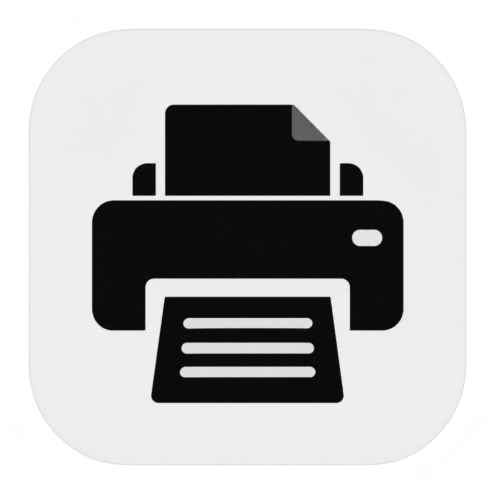
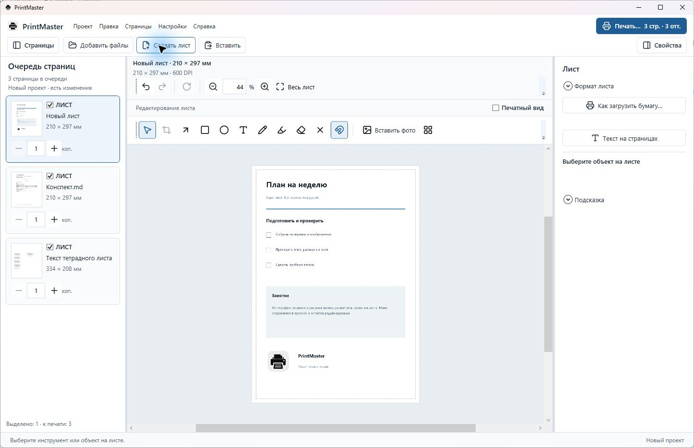
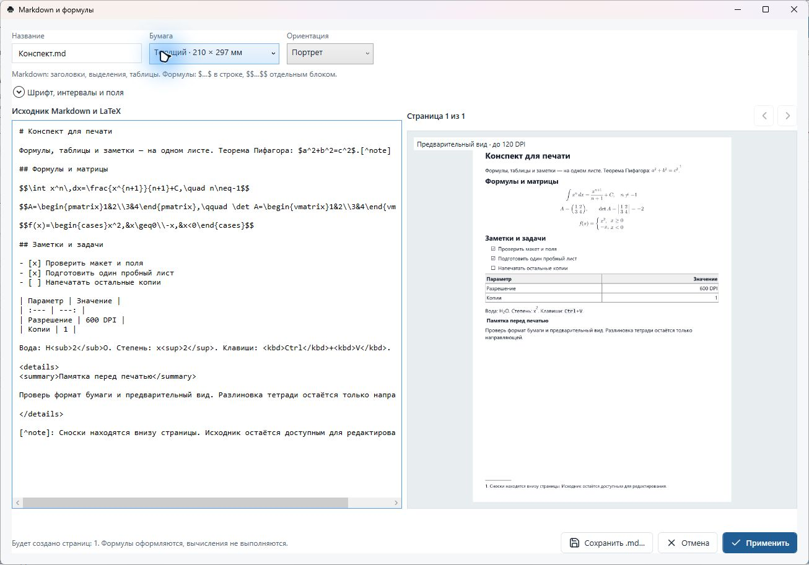
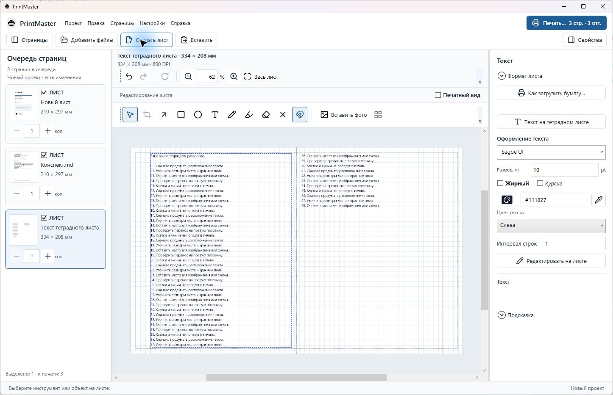
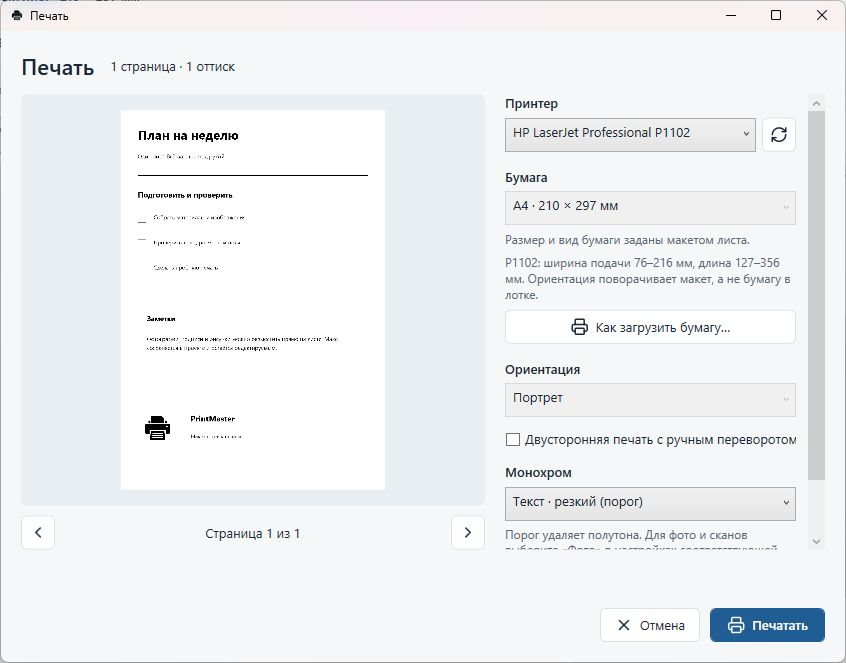

  

<h1 align="center">PrintMaster</h1>

<a href="https://github.com/b1nt1n/PrintMaster/releases/download/v1.0.36/PrintMaster-1.0.36-win-x64.zip"><strong>Download Windows x64</strong></a> · <a href="https://github.com/b1nt1n/PrintMaster/releases/tag/v1.0.36">Release notes</a> · <a href="https://github.com/b1nt1n/PrintMaster/issues">Report a bug</a>

Batch printing, editable sheets and Markdown with mathematics for Windows. Developed for the HP LaserJet Pro P1102.

  
  
  

<strong>English</strong> · <a href="README.ru.md">Русский</a>

<a href="#download-and-run">Download & run</a> · <a href="#a-look-inside">Screenshots</a> · <a href="#what-you-can-do">Features</a> · <a href="#questions">FAQ</a> · <a href="docs/BUILD.md">Build from source</a>

## What you can do

| Prepare | Arrange | Print |
| --- | --- | --- |
| Import PDF, DOCX, PNG, JPEG and BMP | Place pictures, text, arrows, shapes and freehand strokes on a sheet | Set copies separately for every page |
| Write Markdown with LaTeX mathematics | Crop with handles, rotate, resize and align content | Preview sharp text or photo dithering |
| Start from a blank A4, A5 or custom sheet | Flow text across notebook spreads | Use a paper-loading guide and manual duplex assistant |
| Reopen editable projects with their materials | Undo changes and paste into the focused workspace | Export prepared pages to PDF or images |

PrintMaster works locally without an account or Microsoft Office. The application interface is **Russian**; documentation is available in English and Russian.

Version 1.0.36 fixes notebook copy/cut operations, page moves, camera-photo orientation and several editing bugs. Commands and dialogs now use consistent icons and button styles. [Changelog](CHANGELOG.md).

## Download and run

1. Download `PrintMaster-1.0.36-win-x64.zip` from the [release assets](https://github.com/b1nt1n/PrintMaster/releases/tag/v1.0.36).
2. Extract the entire archive to a writable folder. Keep its files and subfolders together.
3. Run `PrintMaster.exe`.
4. With your printer's Windows driver installed, add files or choose **Создать лист** (Create sheet). Open **Печать…** (Print), check the printer and paper, and print a small test.

**Requirements:** Windows 10 or 11, x64, and a Windows printer driver. The archive includes .NET, PDFium and LibreOffice for DOCX conversion. Use the application ZIP; GitHub's source-code archive is for developers.

[Getting started](docs/GUIDE.md) · [Known limitations](docs/LIMITATIONS.md) · [Changes in 1.0.36](CHANGELOG.md)

## A look inside

### Markdown and formulas

Edit the source beside a paginated preview, with inline and display mathematics, matrices, task lists, tables and page-bottom footnotes. PrintMaster formats supplied solutions; it does not solve equations.

### Notebook paper

Choose grid or ruled paper, single sheets or spreads, and adjust measurements to your notebook. Fold, ruling and red-margin guides stay on screen; only added content is printed.

### Print preview

Check paper, copies, scaling and monochrome mode. Individual pages can override the job defaults. Notebook printing shows a loading guide; the duplex assistant pauses before the second pass.

Shortcuts follow focus: **Ctrl+A**, **Ctrl+C**, **Ctrl+V** and **Delete** act on the queue, canvas or active text field. **Ctrl+wheel** zooms the canvas. **Ctrl+Z / Ctrl+Y** undo and redo. [More in the guide](docs/GUIDE.md#keyboard-and-mouse).

## Questions

<strong>Is this only for the HP P1102?</strong>

It was developed and tested on paper with the P1102. Other Windows printers can be selected; check their custom sizes, margins and manual duplex order. PrintMaster is an independent project, unaffiliated with HP.

<strong>Will notebook lines be printed again?</strong>

No. Only added text, pictures and drawings are printed. Measure your notebook before adjusting the guides: dimensions and offsets vary between manufacturers.

<strong>Why do old Markdown pages ask me to apply the source again?</strong>

If prompted, open the Markdown editor, review the source and press **Применить** (Apply) to update pagination. Upgrading from 1.0.35 alone does not require this step. [Compatibility details](CHANGELOG.md).

<strong>Why is the download fairly large?</strong>

It includes .NET and LibreOffice for DOCX conversion, so neither needs a separate installation. Keep the complete folder when moving it.

<strong>Does it support arbitrary HTML or every LaTeX package?</strong>

It supports common math commands and a limited set of HTML formatting tags. Invalid formulas show an error and retain their source. Code uses a monospace font without syntax highlighting. See [limitations](docs/LIMITATIONS.md).

## Development and feedback

[Build and test](docs/BUILD.md) · [Contributing](CONTRIBUTING.md) · [Release history](CHANGELOG.md)

Report the app version, steps, expected result and a small example without private data. For printing issues, include the driver, paper dimensions, orientation, monochrome mode and a preview screenshot.

## License and acknowledgements

PrintMaster's original code is available under the [MIT license](LICENSE). Bundled libraries, fonts, icons and LibreOffice retain their respective licenses. See [third-party components](THIRD-PARTY.md) and [license inventory](docs/licenses/LICENSE-MANIFEST.md).
