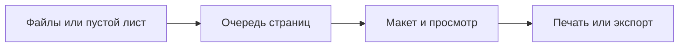

  

<h1 align="center">PrintMaster</h1>

<a href="https://github.com/b1nt1n/PrintMaster/releases/download/v1.0.36/PrintMaster-1.0.36-win-x64.zip"><strong>Скачать Windows x64</strong></a> · <a href="https://github.com/b1nt1n/PrintMaster/releases/tag/v1.0.36">Описание релиза</a> · <a href="https://github.com/b1nt1n/PrintMaster/issues">Сообщить об ошибке</a>

<strong>Файлы, макет и печать — в одном окне.</strong>

Рабочее пространство Windows для пакетной печати, изображений и Markdown с формулами. Разработано с учётом HP LaserJet Pro P1102.

  
  
  

<a href="README.md">English</a> · <strong>Русский</strong>

<a href="#скачать-и-запустить">Скачать</a> · <a href="#как-это-выглядит">Скриншоты</a> · <a href="#возможности">Возможности</a> · <a href="#вопросы">FAQ</a> · <a href="docs/BUILD.md">Сборка</a>

## Что изменилось в 1.0.36

- Единые значки Lucide у команд, в диалогах и меню ПКМ; читаемые подписи и согласованные состояния кнопок.
- Исправлены перестановка страниц и копирование/вырезание тетрадного текста: связи, невыделенное содержимое и переполнение сохраняются.
- Новые фото с камеры правильно поворачиваются и отражаются по метаданным; исходные файлы не меняются.
- Исправлены границы количества копий, замена большого выделения текста, выбор одиночной точки и очистка неудачных импортов.

[Полный список изменений](CHANGELOG.md)

## Возможности

| Подготовить | Разместить | Напечатать |
| --- | --- | --- |
| Импортировать PDF, DOCX, PNG, JPEG и BMP | Добавить фото, текст, стрелки, фигуры и рисунки | Задать количество копий каждой страницы |
| Написать Markdown с формулами LaTeX | Обрезать ручками, повернуть, изменить размер и выровнять | Посмотреть резкий текст или дизеринг фотографий |
| Создать пустой A4, A5 или свой формат | Перенести текст между половинами тетрадного разворота | Открыть схему загрузки и помощник ручного переворота |
| Сохранить редактируемый проект с материалами | Отменять правки и вставлять в активную область | Экспортировать готовые страницы в PDF или изображения |

Программа работает локально. Аккаунт, облако и установленный Microsoft Office не нужны. **Интерфейс приложения — на русском**, документация — на русском и английском.

## Скачать и запустить

1. Открой раздел **Releases** этого репозитория и скачай `PrintMaster-1.0.36-win-x64.zip` из **Assets**.
2. Распакуй архив целиком в папку с правом записи. Сохраняй файлы и подпапки вместе.
3. Запусти `PrintMaster.exe`.
4. Установи драйвер своего принтера Windows, затем добавь файлы или нажми **Создать лист**.
5. Открой **Печать…**, проверь принтер и бумагу. Сначала сделай небольшой пробный оттиск.

**Нужно:** Windows 10 или 11, x64, установленный драйвер принтера Windows. Переносимый архив уже включает .NET, PDFium и LibreOffice для DOCX. Скачивай архив приложения, а не автоматически создаваемый GitHub архив исходников.

[Первые шаги](docs/GUIDE.ru.md) · [Ограничения](docs/LIMITATIONS.ru.md) · [Изменения 1.0.36](CHANGELOG.md)

## Как это выглядит

### Из Markdown — в готовый документ

Редактируемый исходник находится рядом с постраничным просмотром. Формулы в строках и отдельных блоках, матрицы, списки задач, таблицы и сноски внизу страниц обрабатываются локально. PrintMaster оформляет вставленное решение, самостоятельно примеры не решает.

### Тетрадный лист с нужными границами

Выбери клетку или обычную линейку, одинарный лист или разворот. Размеры настраиваются под твою тетрадь. Сгиб, разлиновка и красные поля помогают разместить содержимое, а при печати остаются только добавленные объекты.

### Проверка перед отправкой в принтер

Бумага, копии, масштабирование и монохром собраны в окне печати. У отдельных страниц могут быть собственные параметры. Для тетради есть схема загрузки, а помощник двусторонней печати ждёт ручного переворота перед вторым проходом.

## От файла до бумаги

Горячие клавиши учитывают фокус: **Ctrl+A**, **Ctrl+C**, **Ctrl+V** и **Delete** работают с очередью, холстом или текстовым полем. **Ctrl+колесо** меняет масштаб холста. **Ctrl+Z / Ctrl+Y** отменяют и повторяют правки. [Подробности](docs/GUIDE.ru.md#клавиатура-и-мышь).

## Вопросы

<strong>Подойдёт только HP P1102?</strong>

Программа разрабатывалась и проверялась на бумаге с этим принтером. Другие установленные принтеры Windows тоже можно выбрать, но размеры, аппаратные поля и порядок ручного переворота нужно проверить отдельно. PrintMaster — независимый проект, а не программа HP.

<strong>Клеточки и красные поля напечатаются повторно?</strong>

Нет. Разлиновка, сгиб и поля нужны для размещения на уже разлинованной бумаге. Печатается добавленное содержимое. Измерь свою тетрадь: размеры и отступы у разных производителей отличаются.

<strong>Почему старый Markdown нужно заново применить?</strong>

Изменились правила разбиения на страницы. Открой редактор Markdown, проверь исходник и нажми **Применить**. Так страницы обновляются явно, без потери конца текста и автоматического восстановления намеренно удалённых листов. Формат проекта 10 читает версии 1–10; новые проекты открывай новой программой.

В 1.0.36 сохранены формат проекта 10 и поколение разметки Markdown 3 из 1.0.35. Сам переход с 1.0.35 не требует ещё раз нажимать «Применить».

<strong>Почему архив довольно большой?</strong>

Внутри находятся .NET для Windows и локальная поставка LibreOffice для DOCX. Устанавливать их отдельно не требуется. При переносе сохраняй всю папку программы.

<strong>Работает любой HTML и весь LaTeX?</strong>

Поддерживается описанное подмножество Markdown, распространённые математические команды и несколько HTML-тегов оформления. Ошибка формулы показывается явно, исходник сохраняется в редакторе. Код печатается моноширинным шрифтом без подсветки синтаксиса. Подробнее — в [ограничениях](docs/LIMITATIONS.ru.md).

## Разработка и обратная связь

[Сборка и проверки](docs/BUILD.md) · [Как помочь проекту](CONTRIBUTING.md) · [История изменений](CHANGELOG.md)

Для сообщения об ошибке укажи версию, действия, ожидаемый результат и небольшой пример без личных данных. Если проблема с печатью — добавь драйвер принтера, размеры бумаги, ориентацию и режим монохрома. Приложи скриншот предпросмотра; личные документы публиковать не нужно.

## Лицензия и благодарности

Собственный код PrintMaster распространяется по [MIT](LICENSE). Библиотеки, шрифты, иконки и LibreOffice сохраняют свои лицензии. Перечень — в [THIRD-PARTY.md](THIRD-PARTY.md) и [реестре лицензий](docs/licenses/LICENSE-MANIFEST.md).
